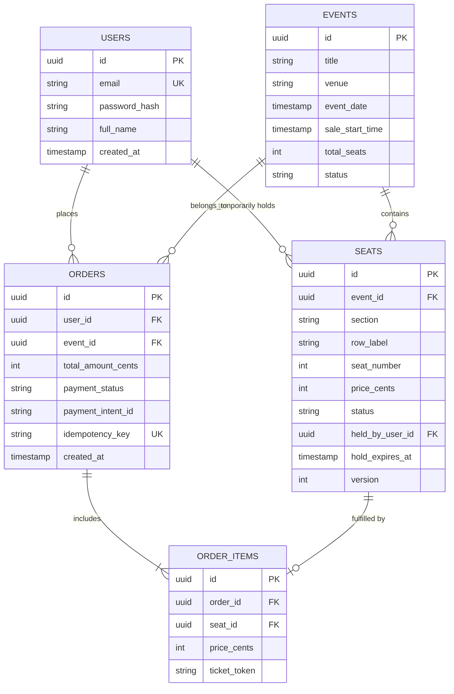

# TicketHub: System Architecture & Flash-Sale Design Document

TicketHub is a high-performance, distributed ticketing platform that handles event discovery, real-time seat selection, temporary seat holds, and secure payment processing. This design document establishes the engineering blueprint for handling everyday traffic as well as extreme flash-sale spikes (e.g., 200,000 fans competing for 20,000 concert seats in 10 minutes) with absolute data correctness, sub-second latency, and fairness.

---

## 1. System Requirements

### 1.1 Functional Requirements
1. **Event Discovery & Browsing:** Users can search and filter upcoming events (concerts, festivals, sports) by title, artist, city, category, and date.
2. **Interactive Seat Map & Real-Time Availability:** Users can inspect a venue map displaying individual seats categorized as `AVAILABLE`, `HELD`, or `SOLD`.
3. **Temporary Seat Hold (Reservation):** Authenticated users can place a temporary 10-minute lock on up to 4 selected seats. During this hold period, no other user can hold or purchase these seats.
4. **Checkout & Secure Payment:** Users can purchase their held seats using credit cards or digital wallets. Upon payment confirmation, the seats transition permanently to `SOLD`.
5. **Automatic Hold Expiration:** If the 10-minute hold window elapses without completed payment, the system automatically releases the held seats back to `AVAILABLE`.
6. **Order Management & Digital Tickets:** Users can view their order history, order status, and retrieve digital tickets with cryptographically signed QR codes for entry scanning.

### 1.2 Non-Functional Requirements
- **Correctness (Zero Double-Booking):** The system must guarantee strict ACID consistency for inventory. Under no circumstances can two concurrent users purchase or hold the same physical seat (zero overselling).
- **Speed & Low Latency:**
  - Event catalog and seat map read queries: P99 < 150 ms.
  - Seat hold and checkout transactions: P99 < 500 ms.
- **Fairness:** During high-demand flash sales, ticket allocation must follow strict First-Come, First-Served (FIFO) semantics. Automated bots and scrapers must be blocked, and legitimate users must not be starved by network race conditions.
- **High Availability & Fault Tolerance:** 99.99% service uptime. The system must degrade gracefully during flash sales using queue-based backpressure (virtual waiting room) rather than throwing HTTP 500/504 errors.
- **Auditability & Idempotency:** All payment and seat-holding operations must be strictly idempotent to prevent duplicate charges or orphaned reservations from client retries.

---

## 2. Traffic & Capacity Estimations

### 2.1 Baseline Metrics & Assumptions
- **Registered Users:** 2,000,000 (2 million users).
- **Normal Day Traffic:**
  - **Daily Visitors:** 50,000 unique visitors / day.
  - **Page Views per Visitor:** 10 pages / visitor.
  - **Total Daily Page Views:** $50,000 \times 10 = 500,000$ page views / day.
  - **Normal Ticket Sales:** 5,000 tickets sold / day.
  - **Seconds per Day:** $24 \times 60 \times 60 = 86,400\text{ seconds}$.
- **"Big Sale" Peak Event (Flash Crowd):**
  - **Concert Capacity:** 20,000 seats.
  - **Surge Audience:** 200,000 concurrent users attempting to buy seats within the first 10 minutes ($600\text{ seconds}$).
  - **User Interaction Rate:** Each user generates an estimated 15 requests over the 10-minute window (landing, waiting room polling, seat map fetch, repeated hold attempts, checkout).

---

### 2.2 Mathematical Calculations

#### A. Normal Day Traffic
1. **Average Read Throughput (Page Views / sec):**
   $$\text{Normal Read RPS} = \frac{500,000\text{ requests}}{86,400\text{ seconds}} \approx 5.79\text{ RPS}$$
2. **Peak Normal Read Throughput ($3\times$ diurnal peak factor):**
   $$\text{Peak Normal Read RPS} = 5.79 \times 3 \approx 17.4\text{ RPS}$$
3. **Average Write Throughput (Ticket Purchases / sec):**
   $$\text{Normal Write RPS} = \frac{5,000\text{ purchases}}{86,400\text{ seconds}} \approx 0.058\text{ writes/sec}$$
4. **Peak Normal Write Throughput ($3\times$ factor):**
   $$\text{Peak Normal Write RPS} = 0.058 \times 3 \approx 0.174\text{ writes/sec}$$

#### B. "Big Sale" Peak Traffic (10-Minute Surge = 600 Seconds)
1. **Total Requests Generated:**
   $$\text{Total Surge Requests} = 200,000\text{ users} \times 15\text{ requests} = 3,000,000\text{ requests in } 600\text{ s}$$
2. **Peak Read & Polling Throughput:**
   $$\text{Surge Read RPS} = \frac{3,000,000\text{ requests}}{600\text{ seconds}} = 5,000\text{ RPS}$$
   *(Initial burst in the opening 60 seconds reaches 12,000+ RPS).*
3. **Seat Hold Write Attempts:**
   Assuming each user attempts an average of 2 seat-hold transactions before succeeding or failing:
   $$\text{Hold Attempts} = 200,000 \times 2 = 400,000\text{ write attempts in } 600\text{ s}$$
   $$\text{Average Hold Write RPS} = \frac{400,000}{600\text{ seconds}} \approx 667\text{ write requests/sec}$$
   *(Peak burst rate during the first minute exceeds 2,500 write requests/sec).*
4. **Successful Order Checkout Throughput:**
   All 20,000 available seats sell out within the 10-minute window:
   $$\text{Order Checkout RPS} = \frac{20,000\text{ tickets}}{600\text{ seconds}} \approx 33.3\text{ successful checkouts/sec}$$

---

### 2.3 Traffic Profile Comparison

| Metric | Normal Day | Big Sale Peak (10 min) | Spike Factor |
| :--- | :--- | :--- | :--- |
| **Active Users / Window** | 50,000 / day | 200,000 / 10 minutes | **$\sim 576\times$ user density** |
| **Read Throughput** | $\sim 5.8\text{ RPS}$ | $\sim 5,000 - 12,000\text{ RPS}$ | **$\sim 860\times - 2,070\times$ increase** |
| **Write Throughput (Holds)** | $\sim 0.06\text{ writes/sec}$ | $\sim 667 - 2,500\text{ writes/sec}$ | **$\sim 11,500\times - 43,000\times$ increase** |
| **Inventory Contention** | Near 0 (scattered events) | **10 users competing per 1 seat** | Extreme row-level lock contention |
| **Failure Mode Without Mitigation**| Negligible load | Complete DB lock collapse, connection exhaustion | Immediate site crash |

**Key Architectural Insight:** Normal traffic is easily sustained by a single miniature server and database. However, the Big Sale concentrates a massive surge of concurrent writes onto the *exact same 20,000 rows* in a single table. Handling this requires queue-based backpressure, caching, and atomic lock management.

---

## 3. REST API Design

TicketHub adheres to standard RESTful principles, utilizing predictable JSON payloads, standard HTTP status codes, and idempotency keys on mutating endpoints.

### 3.1 `GET /api/v1/events`
Browse and search available events with pagination and filtering.

- **Query Parameters:**
  - `query` (string, optional): Search keyword (e.g., "Coldplay").
  - `category` (string, optional): `CONCERT`, `SPORTS`, `THEATER`.
  - `city` (string, optional): Filter by venue city.
  - `page` (integer, default: 1): Page index.
  - `limit` (integer, default: 20): Results per page (max 100).
- **Responses:**
  - `200 OK`:
    ```json
    {
      "data": [
        {
          "id": "evt_9b1deb4d",
          "title": "Coldplay - Music of the Spheres",
          "venue": "Wembley Stadium",
          "city": "London",
          "event_date": "2026-11-15T19:30:00Z",
          "sale_start_time": "2026-11-01T10:00:00Z",
          "status": "UPCOMING",
          "min_price_cents": 6500
        }
      ],
      "pagination": { "page": 1, "limit": 20, "total_events": 142 }
    }
    ```

---

### 3.2 `GET /api/v1/events/{eventId}/seats`
Retrieve the real-time seat map and status for an event.

- **Path Parameters:**
  - `eventId` (string, required): Unique identifier of the event.
- **Responses:**
  - `200 OK`:
    ```json
    {
      "event_id": "evt_9b1deb4d",
      "total_seats": 20000,
      "available_seats": 1420,
      "seats": [
        {
          "id": "seat_101",
          "section": "A1",
          "row": "12",
          "seat_number": 4,
          "price_cents": 12500,
          "status": "AVAILABLE"
        },
        {
          "id": "seat_102",
          "section": "A1",
          "row": "12",
          "seat_number": 5,
          "price_cents": 12500,
          "status": "HELD"
        }
      ]
    }
    ```
  - `404 Not Found`: Event does not exist.

---

### 3.3 `POST /api/v1/events/{eventId}/holds`
Place a temporary 10-minute hold on one or more selected seats.

- **Headers:**
  - `Authorization: Bearer <jwt_token>`
  - `Idempotency-Key: <unique_client_uuid>`
- **Request Body:**
  ```json
  {
    "seat_ids": ["seat_101", "seat_102"]
  }
  ```
- **Responses:**
  - `201 Created`:
    ```json
    {
      "hold_id": "hld_4a71f0c2",
      "event_id": "evt_9b1deb4d",
      "user_id": "usr_88291aef",
      "seat_ids": ["seat_101", "seat_102"],
      "total_amount_cents": 25000,
      "expires_at": "2026-11-01T10:10:00Z",
      "hold_duration_seconds": 600
    }
    ```
  - `400 Bad Request`: Exceeds maximum 4 seats per transaction or malformed IDs.
  - `409 Conflict`: One or more requested seats are already `HELD` or `SOLD`.
  - `429 Too Many Requests`: Rate limit exceeded.

---

### 3.4 `POST /api/v1/orders/checkout`
Process payment and convert held seats into confirmed ticket purchases.

- **Headers:**
  - `Authorization: Bearer <jwt_token>`
  - `Idempotency-Key: <unique_client_uuid>`
- **Request Body:**
  ```json
  {
    "hold_id": "hld_4a71f0c2",
    "payment_method_id": "pm_card_visa_4242",
    "billing_address": {
      "country": "US",
      "postal_code": "94103"
    }
  }
  ```
- **Responses:**
  - `200 OK`:
    ```json
    {
      "order_id": "ord_8830112c",
      "status": "PAID",
      "event_id": "evt_9b1deb4d",
      "total_amount_cents": 25000,
      "tickets_count": 2,
      "confirmation_code": "TH-9821-XQ",
      "created_at": "2026-11-01T10:04:12Z"
    }
    ```
  - `400 Bad Request`: Payment provider rejected card or hold has expired.
  - `409 Conflict`: Hold expired and seats were claimed by another buyer.

---

### 3.5 `GET /api/v1/users/me/tickets`
Retrieve order history and digital admission tickets for the authenticated user.

- **Headers:**
  - `Authorization: Bearer <jwt_token>`
- **Responses:**
  - `200 OK`:
    ```json
    {
      "orders": [
        {
          "order_id": "ord_8830112c",
          "event_title": "Coldplay - Music of the Spheres",
          "venue": "Wembley Stadium",
          "event_date": "2026-11-15T19:30:00Z",
          "status": "CONFIRMED",
          "tickets": [
            {
              "ticket_id": "tkt_001",
              "section": "A1",
              "row": "12",
              "seat_number": 4,
              "qr_code_payload": "https://api.tickethub.com/v1/verify/tkt_001?sig=9fbc8"
            }
          ]
        }
      ]
    }
    ```

---

## 4. Data Model & Double-Booking Prevention

### 4.1 Entity Relational Diagram (ERD)



---

### 4.2 SQL Schema Definitions & Constraints

```sql
-- 1. USERS TABLE
CREATE TABLE users (
    id UUID PRIMARY KEY DEFAULT gen_random_uuid(),
    email VARCHAR(255) NOT NULL UNIQUE,
    password_hash VARCHAR(255) NOT NULL,
    full_name VARCHAR(150) NOT NULL,
    phone VARCHAR(32),
    created_at TIMESTAMP WITH TIME ZONE DEFAULT CURRENT_TIMESTAMP NOT NULL,
    updated_at TIMESTAMP WITH TIME ZONE DEFAULT CURRENT_TIMESTAMP NOT NULL
);

-- 2. EVENTS TABLE
CREATE TABLE events (
    id UUID PRIMARY KEY DEFAULT gen_random_uuid(),
    title VARCHAR(255) NOT NULL,
    venue VARCHAR(255) NOT NULL,
    event_date TIMESTAMP WITH TIME ZONE NOT NULL,
    sale_start_time TIMESTAMP WITH TIME ZONE NOT NULL,
    total_seats INT NOT NULL CHECK (total_seats > 0),
    status VARCHAR(32) NOT NULL DEFAULT 'DRAFT' 
        CHECK (status IN ('DRAFT', 'UPCOMING', 'ON_SALE', 'SOLD_OUT', 'COMPLETED')),
    created_at TIMESTAMP WITH TIME ZONE DEFAULT CURRENT_TIMESTAMP NOT NULL
);

-- 3. SEATS TABLE (Core inventory with state management)
CREATE TABLE seats (
    id UUID PRIMARY KEY DEFAULT gen_random_uuid(),
    event_id UUID NOT NULL REFERENCES events(id) ON DELETE CASCADE,
    section VARCHAR(32) NOT NULL,
    row_label VARCHAR(16) NOT NULL,
    seat_number INT NOT NULL,
    price_cents INT NOT NULL CHECK (price_cents >= 0),
    status VARCHAR(16) NOT NULL DEFAULT 'AVAILABLE'
        CHECK (status IN ('AVAILABLE', 'HELD', 'SOLD')),
    held_by_user_id UUID REFERENCES users(id) ON DELETE SET NULL,
    hold_expires_at TIMESTAMP WITH TIME ZONE,
    version INT NOT NULL DEFAULT 0,
    created_at TIMESTAMP WITH TIME ZONE DEFAULT CURRENT_TIMESTAMP NOT NULL,
    updated_at TIMESTAMP WITH TIME ZONE DEFAULT CURRENT_TIMESTAMP NOT NULL,
    
    -- Constraint 1: Physical seat uniqueness per event
    CONSTRAINT uq_event_physical_seat UNIQUE (event_id, section, row_label, seat_number)
);

-- Indexes for performance
CREATE INDEX idx_seats_event_status ON seats(event_id, status);
CREATE INDEX idx_seats_hold_expiry ON seats(status, hold_expires_at) 
    WHERE status = 'HELD';

-- 4. ORDERS TABLE
CREATE TABLE orders (
    id UUID PRIMARY KEY DEFAULT gen_random_uuid(),
    user_id UUID NOT NULL REFERENCES users(id),
    event_id UUID NOT NULL REFERENCES events(id),
    total_amount_cents INT NOT NULL CHECK (total_amount_cents >= 0),
    payment_status VARCHAR(32) NOT NULL DEFAULT 'PENDING'
        CHECK (payment_status IN ('PENDING', 'PAID', 'FAILED', 'REFUNDED')),
    payment_intent_id VARCHAR(255),
    idempotency_key VARCHAR(128) NOT NULL UNIQUE,
    created_at TIMESTAMP WITH TIME ZONE DEFAULT CURRENT_TIMESTAMP NOT NULL
);

-- 5. ORDER_ITEMS TABLE
CREATE TABLE order_items (
    id UUID PRIMARY KEY DEFAULT gen_random_uuid(),
    order_id UUID NOT NULL REFERENCES orders(id) ON DELETE CASCADE,
    seat_id UUID NOT NULL REFERENCES seats(id),
    price_cents INT NOT NULL,
    ticket_token VARCHAR(255) NOT NULL UNIQUE,
    
    -- Constraint 2: Each seat can only ever belong to one order
    CONSTRAINT uq_seat_single_order UNIQUE (seat_id)
);
```

---

### 4.3 Preventing Double-Booking (Concurrency & Transaction Strategy)

Double-booking occurs when two concurrent requests read seat state as "available" simultaneously, and both proceed to reserve it. TicketHub solves this definitively through **multi-layered database constraints and atomic state transitions**:

#### Layer 1: Relational Uniqueness Constraints
- `uq_event_physical_seat`: Guarantees that a physical coordinate (Section A1, Row 12, Seat 4) cannot be registered twice in an event.
- `uq_seat_single_order`: Enforces that a seat ID can never appear in more than one confirmed order item.

#### Layer 2: Atomic Conditional Update for Seat Holds
Instead of a naive "read-then-write" query pattern, TicketHub uses an atomic SQL `UPDATE` statement guarded by optimistic locking conditions:

```sql
UPDATE seats
SET status = 'HELD',
    held_by_user_id = $userId,
    hold_expires_at = NOW() + INTERVAL '10 minutes',
    version = version + 1,
    updated_at = NOW()
WHERE id IN ($seatId1, $seatId2)
  AND event_id = $eventId
  AND (
    status = 'AVAILABLE'
    OR (status = 'HELD' AND hold_expires_at < NOW())
  );
```

**How It Prevents Race Conditions:**
1. **Row-Level Mutual Exclusion:** The database engine places exclusive write locks on candidate rows during statement execution.
2. **Atomic State Evaluation:** Even if 10,000 users attempt to hold Seat #101 simultaneously, the database executes updates sequentially per row. The first transaction finds `status = 'AVAILABLE'`, changes it to `'HELD'`, and commits.
3. **Immediate Rejection of Colliding Requests:** The other 9,999 transactions evaluate the `WHERE` clause after the first update commits, find that `status` is already `'HELD'` (and unexpired), and match zero rows.
4. **Application Validation:**
   ```javascript
   if (result.rowCount !== requestedSeatIds.length) {
     // At least one seat was claimed by someone else; abort hold
     throw new ConflictException("One or more selected seats are no longer available.");
   }
   ```

#### Layer 3: Pessimistic Row Lock During Checkout
When the user submits payment, the checkout transaction explicitly locks the seats to guarantee that background cleanup tasks cannot release the hold while payment is in-flight:

```sql
BEGIN TRANSACTION ISOLATION LEVEL READ COMMITTED;

-- 1. Lock held seats exclusively for this user
SELECT id, price_cents FROM seats
WHERE id IN ($seatIds)
  AND event_id = $eventId
  AND held_by_user_id = $userId
  AND status = 'HELD'
  AND hold_expires_at > NOW()
FOR UPDATE; -- Blocks any concurrent hold-sweeper or modification

-- Check if all requested seats were successfully locked
-- If count != seatIds.length, ROLLBACK and return 409 Conflict

-- 2. Create Order record
INSERT INTO orders (id, user_id, event_id, total_amount_cents, payment_status, idempotency_key)
VALUES ($orderId, $userId, $eventId, $totalPrice, 'PAID', $idempotencyKey);

-- 3. Transition seats to permanently SOLD
UPDATE seats
SET status = 'SOLD',
    held_by_user_id = NULL,
    hold_expires_at = NULL,
    version = version + 1
WHERE id IN ($seatIds);

-- 4. Create Order Items (digital ticket records)
INSERT INTO order_items (order_id, seat_id, price_cents, ticket_token)
VALUES ...;

COMMIT;
```

---

## 5. System Architecture & Big-Sale Resilience

### 5.1 Architecture Diagram

```
                              [ 200,000 Fans on Mobile / Web ]
                                             │
                                             ▼
                     ┌───────────────────────────────────────────────┐
                     │          Global CDN & Edge Layer              │
                     │  - Cloudflare Edge (DDoS Mitigation, WAF)     │
                     │  - Static Asset & Event Metadata Caching      │
                     └───────────────────────┬───────────────────────┘
                                             │
                                             ▼
                     ┌───────────────────────────────────────────────┐
                     │      Virtual Waiting Room / Token Gate        │
                     │  - Throttles 200k users to 1,000 users/minute │
                     │  - Cryptographic Admission Cookie (FIFO)      │
                     └───────────────────────┬───────────────────────┘
                                             │
                                             ▼
                     ┌───────────────────────────────────────────────┐
                     │     API Gateway / Layer 7 Load Balancer       │
                     │  - Rate Limiting, JWT Validation, SSL Term.   │
                     └───────┬───────────────────────────────┬───────┘
                             │                               │
                ┌────────────┴─────────────┐   ┌─────────────┴────────────┐
                ▼                          ▼   ▼                          ▼
         ┌───────────────┐         ┌───────────────┐              ┌───────────────┐
         │ Event Service │         │ Hold Service  │              │ Order Service │
         │ (Stateless)   │         │ (Stateless)   │              │ (Stateless)   │
         └───────┬───────┘         └───────┬───────┘              └───────┬───────┘
                 │                         │                              │
                 │              ┌──────────┴──────────┐                   │
                 ▼              ▼                     ▼                   ▼
       ┌───────────────────────────────┐   ┌───────────────────────────────┐
       │     Redis In-Memory Cluster   │   │     Stripe / Payment Gateway  │
       │ - Seat Status Bitmaps/Hashes  │   │ - Idempotent Charge API       │
       │ - Distributed Lock / Hold TTL │   └───────────────────────────────┘
       └───────────────┬───────────────┘                                  │
                       │                                                  │
                       │          ┌───────────────────────┐               │
                       │          │ PgBouncer Pooler      │               │
                       │          └───────────┬───────────┘               │
                       │                      │                           │
                       ▼                      ▼                           ▼
        ┌──────────────────────────────────────────────────────────────────┐
        │                 Primary Relational DB (PostgreSQL)              │
        │ - Strict ACID Transactions, Row-Level Locks                     │
        │ - Master for Writes (Holds, Checkouts)                          │
        └───────────────────────────────┬──────────────────────────────────┘
                                        │ (Streaming Replication)
                                        ▼
        ┌──────────────────────────────────────────────────────────────────┐
        │                 Read Replica PostgreSQL Cluster                 │
        │ - User order history, profile queries, reporting                 │
        └──────────────────────────────────────────────────────────────────┘
                                        ▲
                                        │
        ┌───────────────────────────────┴──────────────────────────────────┐
        │            Asynchronous Workers & Queue (BullMQ / SQS)           │
        │ - Expired Hold Sweeper (reconciles expired locks every 5s)       │
        │ - Ticket PDF generation, email/SMS dispatch                      │
        └──────────────────────────────────────────────────────────────────┘
```

---

### 5.2 Component Breakdown & Big-Sale Survival Strategy

1. **Edge CDN (Cloudflare) & Static Offloading:**
   - Caches event marketing assets, static seat-map SVGs, and event details at edge points-of-presence worldwide.
   - Shields the origin servers from over **90% of raw request volume**.

2. **Virtual Waiting Room (Shock Absorber & Fair Admission):**
   - **The Problem:** 200,000 users hitting the backend at once would spawn 200,000 concurrent database connections, exhausting memory and causing immediate connection starvation.
   - **The Solution:** When active traffic exceeds safe backend capacity, incoming users enter a Virtual Waiting Room (managed at the edge via Cloudflare or Redis sorted sets).
   - Users receive an estimated wait time and position number.
   - The queue drains at a regulated rate matching database write capacity: **1,000 admitted users per minute** receive a time-bound, cryptographically signed admission token (HMAC-SHA256) allowing access to the seat selection and checkout API.

3. **In-Memory Redis Cache & Distributed Lock:**
   - Maintains an in-memory bitmap or hash of seat statuses for the hot event (`HGET seat_map:evt_9b1deb4d seat_101`).
   - Uses atomic Lua scripts for the initial hold attempt. If Redis detects the seat is already held, it rejects the request in 0.5 milliseconds without touching PostgreSQL. Only valid prospective holds proceed to the database transaction.

4. **Database Connection Pooler (PgBouncer):**
   - Keeps PostgreSQL connections capped at a healthy threshold (e.g., 200 dedicated connections) regardless of how many application instances scale up. Prevents process thrashing and thread starvation.

5. **Asynchronous Background Sweeper:**
   - Runs a lightweight cron every 5 seconds querying `WHERE status = 'HELD' AND hold_expires_at < NOW()`.
   - Batch resets expired holds to `AVAILABLE`, automatically republishing inventory without blocking checkout requests.

---

## 6. Architectural Trade-Offs

### 6.1 Trade-Off 1: Virtual Waiting Room (Fair Queue) vs. Elastic Infinite Auto-Scaling
- **Decision:** Implement a strict Virtual Waiting Room that throttles access to 1,000 users/minute during major on-sales, rather than attempting to scale application and database tiers to serve 200,000 simultaneous checkouts.
- **Advantages:**
  - **Systemic Survival:** Relational databases have a physical limit on write concurrency for the same table. Attempting to horizontally scale web servers to handle 200,000 simultaneous transactions causes database connection pool exhaustion and table lock gridlock.
  - **Absolute Fairness:** First-Come, First-Served queue ordering guarantees that early fans get tickets, eliminating the lottery effect where botnets overwhelm human users.
- **Disadvantages:**
  - **User Experience Friction:** Users must wait in a queue page for minutes instead of having immediate access.
  - **Complexity:** Requires edge-based queue routing, state synchronization, and HMAC admission cookie verification.

---

### 6.2 Trade-Off 2: Atomic Relational Updates vs. Eventual Consistency (NoSQL)
- **Decision:** Utilize PostgreSQL with strict ACID transactions and row-level locks for inventory management, rather than a globally distributed NoSQL database (e.g., DynamoDB or Cassandra) with eventual consistency.
- **Advantages:**
  - **Correctness Over Everything:** Under the CAP theorem, ticketing requires **Consistency and Partition Tolerance (CP)** over high Availability (AP). Relational uniqueness constraints guarantee zero double-bookings.
  - **Transactional Atomicity:** Updating seat status, creating orders, and recording payment items occur in an atomic all-or-nothing unit of work.
- **Disadvantages:**
  - **Vertical Bottleneck on Primary:** All inventory writes must pass through a single primary database instance, requiring aggressive edge caching and waiting-room throttling to prevent write saturation.
  - **Higher Operational Overhead:** Requires careful connection pooling (PgBouncer) and read-replica routing.

---

### 6.3 Trade-Off 3: Redis In-Memory Pre-Hold vs. Direct Database-Only Locking
- **Decision:** Place an in-memory Redis reservation layer ahead of PostgreSQL, using atomic Lua scripts to filter out conflicting hold requests before they hit the database.
- **Advantages:**
  - **Database Protection:** When 200,000 users fight over 20,000 seats, over 90% of hold requests are doomed to fail because someone else was a split-second faster. Filtering them in Redis prevents 360,000 doomed transactions from creating contention on the PostgreSQL primary.
  - **Lightning Speed:** Redis responds in sub-millisecond time.
- **Disadvantages:**
  - **Dual-State Synchronization:** Requires careful cache-invalidation logic so that Redis and PostgreSQL never drift out of sync if an application node crashes mid-transaction.
