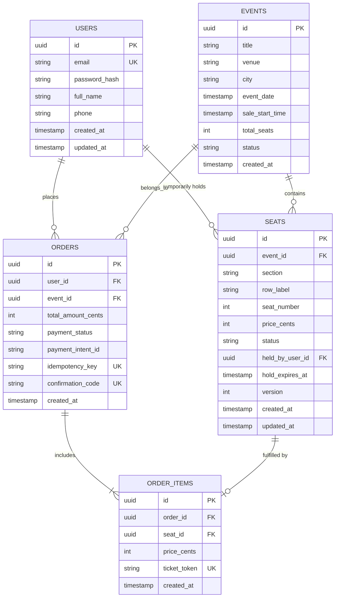
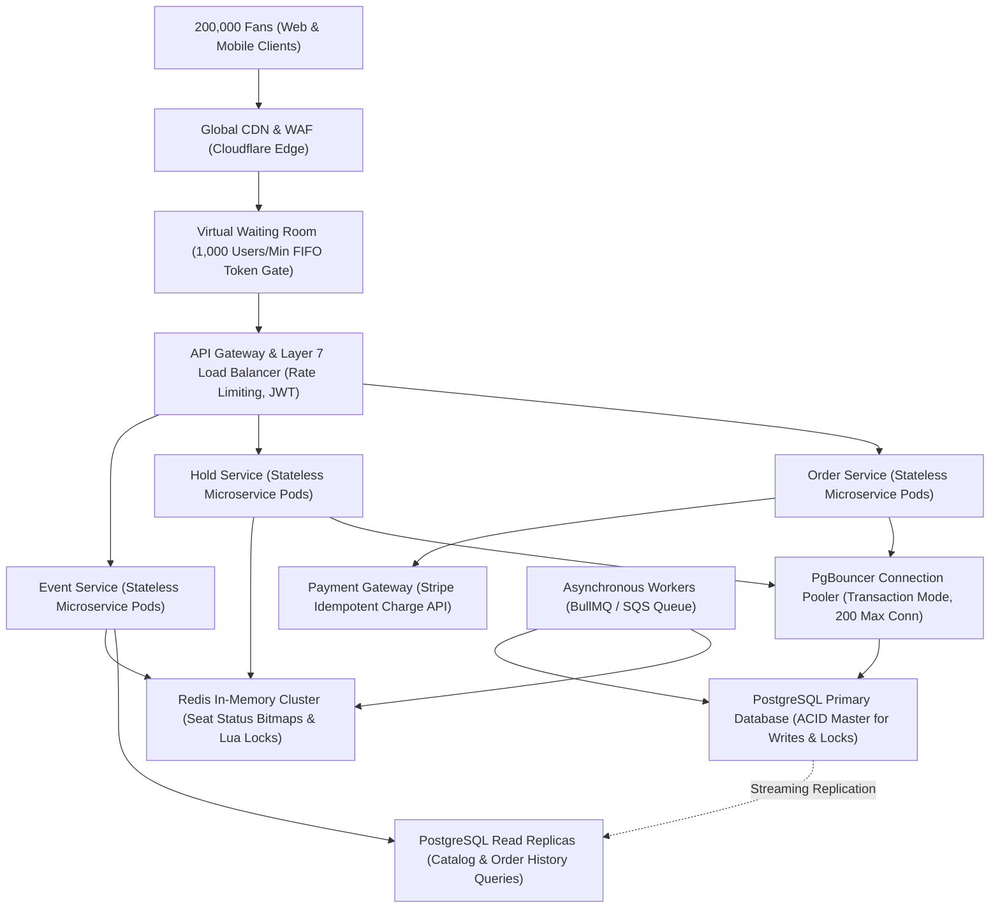

# TicketHub: System Architecture & Flash-Sale Design Document

TicketHub is a high-performance, distributed ticketing platform that handles event discovery, real-time seat selection, temporary seat holds, and secure payment processing. This design document establishes the engineering blueprint for handling everyday traffic as well as extreme flash-sale spikes (e.g., 200,000 fans competing for 20,000 concert seats in 10 minutes) with absolute data correctness, sub-second latency, and fairness.

---

## 1. System Requirements

### 1.1 Functional Requirements
1. **Event Discovery & Browsing:** Users can search and filter upcoming events (concerts, festivals, sports) by title, artist, city, category, and date.
2. **Interactive Seat Map & Real-Time Availability:** Users can inspect a venue map displaying individual seats categorized as `AVAILABLE`, `HELD`, or `SOLD`.
3. **Temporary Seat Hold (Reservation):** Authenticated users can place a temporary 10-minute lock on up to 4 selected seats. During this hold period, no other user can hold or purchase these seats.
4. **Checkout & Secure Payment:** Users can purchase their held seats using credit cards or digital wallets. Upon payment confirmation, the seats transition permanently to `SOLD`.
5. **Automatic Hold Expiration:** If the 10-minute hold window elapses without completed payment, the system automatically releases the held seats back to `AVAILABLE`.
6. **Order Management & Digital Tickets:** Users can view their order history, order status, and retrieve digital tickets with cryptographically signed QR codes for entry scanning.

### 1.2 Non-Functional Requirements
- **Correctness (Zero Double-Booking):** The system must guarantee strict ACID consistency for inventory. Under no circumstances can two concurrent users purchase or hold the same physical seat (zero overselling).
- **Speed & Low Latency:**
  - Event catalog and seat map read queries: P99 < 150 ms.
  - Seat hold and checkout transactions: P99 < 500 ms.
- **Fairness:** During high-demand flash sales, ticket allocation must follow strict First-Come, First-Served (FIFO) semantics. Automated bots and scrapers must be blocked, and legitimate users must not be starved by network race conditions.
- **High Availability & Fault Tolerance:** 99.99% service uptime. The system must degrade gracefully during flash sales using queue-based backpressure (virtual waiting room) rather than throwing HTTP 500/504 errors.
- **Auditability & Idempotency:** All payment and seat-holding operations must be strictly idempotent to prevent duplicate charges or orphaned reservations from client retries.

---

## 2. Traffic & Capacity Estimations

### 2.1 Baseline Metrics & Assumptions
- **Registered Users:** 2,000,000 (2 million users).
- **Normal Day Traffic:**
  - **Daily Visitors:** 50,000 unique visitors / day.
  - **Page Views per Visitor:** 10 pages / visitor.
  - **Total Daily Page Views:** 50,000 * 10 = 500,000 page views / day.
  - **Normal Ticket Sales:** 5,000 tickets sold / day.
  - **Seconds per Day:** 24 * 60 * 60 = 86,400 seconds.
- **"Big Sale" Peak Event (Flash Crowd):**
  - **Concert Capacity:** 20,000 seats.
  - **Surge Audience:** 200,000 concurrent users attempting to buy seats within the first 10 minutes (600 seconds).
  - **User Interaction Rate:** Each user generates an estimated 15 requests over the 10-minute window (landing, waiting room polling, seat map fetch, repeated hold attempts, checkout).

---

### 2.2 Mathematical Calculations

#### A. Normal Day Traffic
1. **Average Read Throughput (Page Views / sec):**
   $$\text{Normal Read RPS} = \frac{500,000\text{ requests}}{86,400\text{ seconds}} \approx 5.79\text{ RPS}$$
   *(Calculation: 500,000 requests / 86,400 seconds = ~5.79 requests per second)*
2. **Peak Normal Read Throughput (3x diurnal peak factor):**
   $$\text{Peak Normal Read RPS} = 5.79 \times 3 \approx 17.4\text{ RPS}$$
   *(Calculation: 5.79 * 3 = ~17.4 requests per second)*
3. **Average Write Throughput (Ticket Purchases / sec):**
   $$\text{Normal Write RPS} = \frac{5,000\text{ purchases}}{86,400\text{ seconds}} \approx 0.058\text{ writes/sec}$$
   *(Calculation: 5,000 purchases / 86,400 seconds = ~0.058 writes per second)*
4. **Peak Normal Write Throughput (3x factor):**
   $$\text{Peak Normal Write RPS} = 0.058 \times 3 \approx 0.174\text{ writes/sec}$$
   *(Calculation: 0.058 * 3 = ~0.174 writes per second)*

#### B. "Big Sale" Peak Traffic (10-Minute Surge = 600 Seconds)
1. **Total Requests Generated:**
   $$\text{Total Surge Requests} = 200,000\text{ users} \times 15\text{ requests} = 3,000,000\text{ requests in } 600\text{ s}$$
   *(Calculation: 200,000 users * 15 requests = 3,000,000 total requests over 600 seconds)*
2. **Peak Read & Polling Throughput:**
   $$\text{Surge Read RPS} = \frac{3,000,000\text{ requests}}{600\text{ seconds}} = 5,000\text{ RPS}$$
   *(Calculation: 3,000,000 requests / 600 seconds = 5,000 RPS average across the window; the initial burst in the opening 60 seconds reaches 12,000+ RPS).*
3. **Seat Hold Write Attempts:**
   Assuming each user attempts an average of 2 seat-hold transactions before succeeding or failing:
   $$\text{Hold Attempts} = 200,000 \times 2 = 400,000\text{ write attempts in } 600\text{ s}$$
   $$\text{Average Hold Write RPS} = \frac{400,000}{600\text{ seconds}} \approx 667\text{ write requests/sec}$$
   *(Calculation: 400,000 attempts / 600 seconds = ~667 write requests per second; peak burst rate during the first minute exceeds 2,500 write requests per second).*
4. **Successful Order Checkout Throughput:**
   All 20,000 available seats sell out within the 10-minute window:
   $$\text{Order Checkout RPS} = \frac{20,000\text{ tickets}}{600\text{ seconds}} \approx 33.3\text{ successful checkouts/sec}$$
   *(Calculation: 20,000 tickets / 600 seconds = ~33.3 successful checkouts per second).*

---

### 2.3 Traffic Profile Comparison

Instead of a generic table, the architectural impact between baseline everyday operations and flash-sale conditions is broken down across five concrete system dimensions:

#### 1. Active Users & Concurrency Density
- **Normal Day Traffic:** 50,000 unique visitors per day spread naturally across 24 hours.
- **Big Sale Peak Traffic (10-Minute Surge):** 200,000 concurrent active users arriving within the initial 10-minute window (600 seconds).
- **Spike Factor & Impact:** An increase of approximately **576x user density** per unit of time, creating massive connection demand at the ingress tier.

#### 2. Read Throughput (Page Views & Availability Checks)
- **Normal Day Traffic:** Approximately 5.8 read requests per second baseline, with peak diurnal traffic reaching ~17.4 RPS.
- **Big Sale Peak Traffic (10-Minute Surge):** Average of 5,000 read requests per second, surging to 12,000+ RPS during opening seat map fetches.
- **Spike Factor & Impact:** An increase of **860x to 2,070x** over normal baseline read traffic, requiring aggressive edge CDN caching and read-replica distribution.

#### 3. Write Throughput (Temporary Seat Holds)
- **Normal Day Traffic:** Approximately 0.06 write requests per second, peaking at ~0.174 writes per second.
- **Big Sale Peak Traffic (10-Minute Surge):** Average of 667 write requests per second, with opening-minute burst rates exceeding 2,500 write requests per second.
- **Spike Factor & Impact:** An increase of **11,500x to 43,000x** in transactional write intensity, creating catastrophic row-level lock contention without queue-based throttling.

#### 4. Physical Inventory Contention
- **Normal Day Traffic:** Near 0 contention across widely scattered events, cities, and dates.
- **Big Sale Peak Traffic (10-Minute Surge):** Extreme contention with **10 active concurrent users competing for every single seat** (200,000 users competing for 20,000 seats).
- **Spike Factor & Impact:** High probability of simultaneous write operations targeting the exact same database rows, demanding atomic serialization and mutual exclusion.

#### 5. Failure Mode Without Mitigation
- **Normal Day Traffic:** Negligible resource load; the single small database operates with ample headroom and sub-50ms latency.
- **Big Sale Peak Traffic (10-Minute Surge):** Instantaneous database connection pool exhaustion, unconstrained process spawning, transaction deadlocks, and cascading thread starvation.
- **Spike Factor & Impact:** Complete site crash within 10 seconds of ticket drop, resulting in dropped TCP connections and HTTP 504 Gateway Timeouts for 100% of users.

**Key Architectural Insight:** Normal traffic is easily sustained by a single miniature server and database instance. However, the Big Sale concentrates a massive surge of concurrent writes onto the exact same 20,000 rows in a single table within seconds. Surviving this requires queue-based backpressure, caching, and atomic lock management.

---

## 3. REST API Design

TicketHub exposes a resource-oriented RESTful API over HTTPS. All payloads are encoded in UTF-8 JSON. Mutating endpoints mandate cryptographic authorization tokens and client-generated idempotency keys to ensure request deduplication during network retries.

### Common Headers
- `Authorization: Bearer <jwt_access_token>`: Authenticates the user session.
- `Idempotency-Key: <uuid_v4>`: Ensures safe client retries without duplicate holds or payments.
- `Content-Type: application/json`: Specifies payload encoding.

---

### 3.1 `GET /api/v1/events`
Browse and search the public event catalog with pagination and faceted filters.

- **Query Parameters:**
  - `query` (string, optional): Keyword search matching event title, artist, or venue.
  - `category` (string, optional): Filter by `CONCERT`, `SPORTS`, `THEATER`.
  - `city` (string, optional): Filter by venue city (e.g., `London`).
  - `page` (integer, default: `1`): Pagination page index.
  - `limit` (integer, default: `20`, max: `100`): Results per page.
- **Responses:**
  - `200 OK`:
    ```json
    {
      "data": [
        {
          "id": "evt_9b1deb4d-3f82-411a-8212-07612f0a8d9a",
          "title": "Coldplay - Music of the Spheres World Tour",
          "venue": "Wembley Stadium",
          "city": "London",
          "event_date": "2026-11-15T19:30:00Z",
          "sale_start_time": "2026-11-01T10:00:00Z",
          "status": "ON_SALE",
          "total_seats": 20000,
          "min_price_cents": 6500,
          "max_price_cents": 25000
        }
      ],
      "pagination": {
        "page": 1,
        "limit": 20,
        "total_items": 142,
        "total_pages": 8
      }
    }
    ```

---

### 3.2 `GET /api/v1/events/{eventId}/seats`
Retrieve the interactive seat map and current availability statuses for an event.

- **Path Parameters:**
  - `eventId` (UUID, required): Unique identifier of the event.
- **Responses:**
  - `200 OK`:
    ```json
    {
      "event_id": "evt_9b1deb4d-3f82-411a-8212-07612f0a8d9a",
      "summary": {
        "total_seats": 20000,
        "available_seats": 1420,
        "held_seats": 850,
        "sold_seats": 17730
      },
      "seats": [
        {
          "id": "seat_a1_12_04",
          "section": "A1",
          "row": "12",
          "seat_number": 4,
          "price_cents": 12500,
          "status": "AVAILABLE"
        },
        {
          "id": "seat_a1_12_05",
          "section": "A1",
          "row": "12",
          "seat_number": 5,
          "price_cents": 12500,
          "status": "HELD"
        }
      ]
    }
    ```
  - `404 Not Found`: Event ID does not exist.

---

### 3.3 `POST /api/v1/events/{eventId}/holds`
Attempt to place a temporary 10-minute hold on up to 4 designated seats.

- **Path Parameters:**
  - `eventId` (UUID, required): Unique identifier of the event.
- **Headers:**
  - `Authorization: Bearer <jwt_access_token>`
  - `Idempotency-Key: <unique_client_uuid>`
- **Request Body:**
  ```json
  {
    "seat_ids": [
      "seat_a1_12_04",
      "seat_a1_12_05"
    ]
  }
  ```
- **Responses:**
  - `201 Created`:
    ```json
    {
      "hold_id": "hld_4a71f0c2-5e91-49b9-9135-d22744ad116e",
      "event_id": "evt_9b1deb4d-3f82-411a-8212-07612f0a8d9a",
      "user_id": "usr_88291aef-bc30-4e89-8cb3-3e198a28795c",
      "seat_ids": [
        "seat_a1_12_04",
        "seat_a1_12_05"
      ],
      "total_amount_cents": 25000,
      "created_at": "2026-11-01T10:00:15Z",
      "expires_at": "2026-11-01T10:10:15Z",
      "hold_duration_seconds": 600
    }
    ```
  - `400 Bad Request`: Payload validation error (e.g., requesting > 4 seats or empty array).
  - `409 Conflict`: One or more requested seats are already `HELD` or `SOLD`. Returns array of colliding seat IDs.
  - `429 Too Many Requests`: Rate limit exceeded or queue token invalid.

---

### 3.4 `DELETE /api/v1/events/{eventId}/holds/{holdId}`
Explicitly release active holds early if a user decides not to complete checkout.

- **Path Parameters:**
  - `eventId` (UUID, required): Event ID.
  - `holdId` (UUID, required): Hold ID to cancel.
- **Headers:**
  - `Authorization: Bearer <jwt_access_token>`
- **Responses:**
  - `204 No Content`: Seats released back to `AVAILABLE`.
  - `404 Not Found`: Hold does not exist or does not belong to the calling user.

---

### 3.5 `POST /api/v1/orders/checkout`
Commit held seats into permanently confirmed ticket purchases following successful payment authorization.

- **Headers:**
  - `Authorization: Bearer <jwt_access_token>`
  - `Idempotency-Key: <unique_client_uuid>`
- **Request Body:**
  ```json
  {
    "hold_id": "hld_4a71f0c2-5e91-49b9-9135-d22744ad116e",
    "event_id": "evt_9b1deb4d-3f82-411a-8212-07612f0a8d9a",
    "payment_method_id": "pm_card_visa_4242",
    "billing_details": {
      "name": "Peter Kush",
      "email": "peter@example.com",
      "postal_code": "SW1A 1AA",
      "country": "GB"
    }
  }
  ```
- **Responses:**
  - `200 OK`:
    ```json
    {
      "order_id": "ord_8830112c-98aa-462a-89a1-5d94726bfcf3",
      "status": "PAID",
      "event_id": "evt_9b1deb4d-3f82-411a-8212-07612f0a8d9a",
      "total_amount_cents": 25000,
      "tickets_count": 2,
      "confirmation_code": "TH-9821-XQ",
      "created_at": "2026-11-01T10:04:12Z",
      "receipt_url": "https://tickethub.com/receipts/ord_8830112c"
    }
    ```
  - `400 Bad Request`: Invalid payment credentials or malformed parameters.
  - `402 Payment Required`: Upstream payment gateway declined charge (e.g., insufficient funds).
  - `409 Conflict`: Hold expired before payment was authorized and seats were claimed by another buyer.

---

### 3.6 `GET /api/v1/users/me/tickets`
Retrieve order history and digital admission tickets for the authenticated user.

- **Headers:**
  - `Authorization: Bearer <jwt_access_token>`
- **Responses:**
  - `200 OK`:
    ```json
    {
      "orders": [
        {
          "order_id": "ord_8830112c-98aa-462a-89a1-5d94726bfcf3",
          "event_title": "Coldplay - Music of the Spheres World Tour",
          "venue": "Wembley Stadium",
          "event_date": "2026-11-15T19:30:00Z",
          "status": "CONFIRMED",
          "tickets": [
            {
              "ticket_id": "tkt_001_a1_12_04",
              "section": "A1",
              "row": "12",
              "seat_number": 4,
              "ticket_holder": "Peter Kush",
              "qr_code_payload": "https://api.tickethub.com/v1/verify/tkt_001_a1_12_04?sig=3f81e9b2c8",
              "issued_at": "2026-11-01T10:04:12Z"
            }
          ]
        }
      ]
    }
    ```

---

### 3.7 `GET /api/v1/waiting-room/status`
Allows waiting room clients to poll their current queue position and obtain admission tokens.

- **Headers:**
  - `Authorization: Bearer <queue_session_token>`
- **Responses:**
  - `200 OK (Queued)`:
    ```json
    {
      "status": "QUEUED",
      "queue_position": 4210,
      "estimated_wait_seconds": 240,
      "admitted": false
    }
    ```
  - `200 OK (Admitted)`:
    ```json
    {
      "status": "ADMITTED",
      "queue_position": 0,
      "admitted": true,
      "admission_token": "eyJh...hmac_admission_token",
      "valid_until": "2026-11-01T10:15:00Z"
    }
    ```

---

## 4. Relational Database Schema & Data Model

TicketHub utilizes PostgreSQL as its primary authoritative transactional data store. The relational model enforces referential integrity, domain constraints, and uniqueness rules at the database engine level.

### 4.1 Entity Relational Diagram (ERD)



---

### 4.2 SQL DDL Schema Definitions & Integrity Constraints

```sql
-- Enable cryptographic UUID extension
CREATE EXTENSION IF NOT EXISTS "pgcrypto";

-- ============================================================================
-- 1. USERS TABLE
-- ============================================================================
CREATE TABLE users (
    id UUID PRIMARY KEY DEFAULT gen_random_uuid(),
    email VARCHAR(255) NOT NULL UNIQUE,
    password_hash VARCHAR(255) NOT NULL,
    full_name VARCHAR(150) NOT NULL,
    phone VARCHAR(32),
    created_at TIMESTAMP WITH TIME ZONE DEFAULT CURRENT_TIMESTAMP NOT NULL,
    updated_at TIMESTAMP WITH TIME ZONE DEFAULT CURRENT_TIMESTAMP NOT NULL
);

-- ============================================================================
-- 2. EVENTS TABLE
-- ============================================================================
CREATE TABLE events (
    id UUID PRIMARY KEY DEFAULT gen_random_uuid(),
    title VARCHAR(255) NOT NULL,
    venue VARCHAR(255) NOT NULL,
    city VARCHAR(100) NOT NULL,
    event_date TIMESTAMP WITH TIME ZONE NOT NULL,
    sale_start_time TIMESTAMP WITH TIME ZONE NOT NULL,
    total_seats INT NOT NULL CHECK (total_seats > 0),
    status VARCHAR(32) NOT NULL DEFAULT 'DRAFT' 
        CHECK (status IN ('DRAFT', 'UPCOMING', 'ON_SALE', 'SOLD_OUT', 'COMPLETED', 'CANCELLED')),
    created_at TIMESTAMP WITH TIME ZONE DEFAULT CURRENT_TIMESTAMP NOT NULL,
    updated_at TIMESTAMP WITH TIME ZONE DEFAULT CURRENT_TIMESTAMP NOT NULL
);

-- ============================================================================
-- 3. SEATS TABLE (Authoritative Inventory & State Tracking)
-- ============================================================================
CREATE TABLE seats (
    id UUID PRIMARY KEY DEFAULT gen_random_uuid(),
    event_id UUID NOT NULL REFERENCES events(id) ON DELETE CASCADE,
    section VARCHAR(32) NOT NULL,
    row_label VARCHAR(16) NOT NULL,
    seat_number INT NOT NULL CHECK (seat_number > 0),
    price_cents INT NOT NULL CHECK (price_cents >= 0),
    status VARCHAR(16) NOT NULL DEFAULT 'AVAILABLE'
        CHECK (status IN ('AVAILABLE', 'HELD', 'SOLD')),
    held_by_user_id UUID REFERENCES users(id) ON DELETE SET NULL,
    hold_expires_at TIMESTAMP WITH TIME ZONE,
    version INT NOT NULL DEFAULT 0,
    created_at TIMESTAMP WITH TIME ZONE DEFAULT CURRENT_TIMESTAMP NOT NULL,
    updated_at TIMESTAMP WITH TIME ZONE DEFAULT CURRENT_TIMESTAMP NOT NULL,
    
    -- Constraint 1: Absolute Physical Uniqueness
    -- Prevents duplicate coordinates from ever being registered for an event
    CONSTRAINT uq_event_physical_seat UNIQUE (event_id, section, row_label, seat_number)
);

-- ============================================================================
-- 4. ORDERS TABLE
-- ============================================================================
CREATE TABLE orders (
    id UUID PRIMARY KEY DEFAULT gen_random_uuid(),
    user_id UUID NOT NULL REFERENCES users(id),
    event_id UUID NOT NULL REFERENCES events(id),
    total_amount_cents INT NOT NULL CHECK (total_amount_cents >= 0),
    payment_status VARCHAR(32) NOT NULL DEFAULT 'PENDING'
        CHECK (payment_status IN ('PENDING', 'PAID', 'FAILED', 'REFUNDED')),
    payment_intent_id VARCHAR(255),
    idempotency_key VARCHAR(128) NOT NULL UNIQUE,
    confirmation_code VARCHAR(32) NOT NULL UNIQUE,
    created_at TIMESTAMP WITH TIME ZONE DEFAULT CURRENT_TIMESTAMP NOT NULL,
    updated_at TIMESTAMP WITH TIME ZONE DEFAULT CURRENT_TIMESTAMP NOT NULL
);

-- ============================================================================
-- 5. ORDER_ITEMS TABLE
-- ============================================================================
CREATE TABLE order_items (
    id UUID PRIMARY KEY DEFAULT gen_random_uuid(),
    order_id UUID NOT NULL REFERENCES orders(id) ON DELETE CASCADE,
    seat_id UUID NOT NULL REFERENCES seats(id),
    price_cents INT NOT NULL CHECK (price_cents >= 0),
    ticket_token VARCHAR(255) NOT NULL UNIQUE,
    created_at TIMESTAMP WITH TIME ZONE DEFAULT CURRENT_TIMESTAMP NOT NULL,
    
    -- Constraint 2: Single-Fulfillment Guarantee
    -- Mathematically ensures a seat can belong to at most one order item forever
    CONSTRAINT uq_seat_single_order UNIQUE (seat_id)
);
```

---

### 4.3 Performance Indexes & Query Optimization Strategy

Under peak traffic, indexing determines whether the database survives or collapses into connection timeouts. The following indexes are applied:

```sql
-- 1. Seat Availability Composite Index:
-- Accelerates real-time seat map lookups and filtering by event and status.
CREATE INDEX idx_seats_event_status ON seats(event_id, status);

-- 2. Partial Index for Expired Hold Sweeping:
-- Only indexes rows currently in HELD state. For 20,000 seats where 1,000 are held,
-- this B-tree contains exactly 1,000 entries rather than 20,000, executing in < 1 ms.
CREATE INDEX idx_seats_held_expiry ON seats(hold_expires_at) 
WHERE status = 'HELD';

-- 3. User Order Lookup Index:
-- Enables instant retrieval of user ticket histories.
CREATE INDEX idx_orders_user_created ON orders(user_id, created_at DESC);

-- 4. Event Discovery Index:
-- Powers event search and date-ordered listing pages.
CREATE INDEX idx_events_date_status ON events(event_date, status);
```

---

## 5. Double-Booking Prevention & Concurrency Locking Strategy

Double-booking occurs when concurrent requests interleave between reading seat availability and committing a reservation. When 10 users fight for the identical seat within the same millisecond, a naive architecture experiences race conditions:

```
User A -> SELECT status FROM seats WHERE id = 'seat_101' -> Returns 'AVAILABLE'
User B -> SELECT status FROM seats WHERE id = 'seat_101' -> Returns 'AVAILABLE'
User A -> UPDATE seats SET status = 'HELD', held_by_user_id = 'User A' -> Success
User B -> UPDATE seats SET status = 'HELD', held_by_user_id = 'User B' -> Overwrites User A!
```

TicketHub solves this using a multi-layered concurrency architecture combining atomic conditional SQL mutations, pessimistic checkout locking, and Redis distributed pre-locks.

---

### 5.1 Layer 1: Atomic Conditional SQL Updates for Seat Holds

Rather than reading before writing, TicketHub merges verification and mutation into a single atomic SQL statement guarded by state conditions:

```sql
UPDATE seats
SET status = 'HELD',
    held_by_user_id = $userId,
    hold_expires_at = NOW() + INTERVAL '10 minutes',
    version = version + 1,
    updated_at = NOW()
WHERE id IN ($seatId1, $seatId2)
  AND event_id = $eventId
  AND (
    status = 'AVAILABLE' 
    OR (status = 'HELD' AND hold_expires_at < NOW())
  );
```

#### How This Guarantees Concurrency Correctness:
1. **Row-Level Mutual Exclusion:** When PostgreSQL processes an `UPDATE`, it acquires an exclusive row-level write lock (`ExclusiveLock`) on candidate tuples.
2. **Sequential Queueing:** If 10 transactions arrive simultaneously for Seat #101, PostgreSQL serializes their execution on that specific row.
3. **Atomic Evaluation of Predicate:** The first transaction acquires the lock, observes `status = 'AVAILABLE'`, updates the row to `'HELD'`, increments `version`, and commits.
4. **Immediate Rejection:** The remaining 9 transactions unblock and evaluate the `WHERE` clause against the newly committed tuple. Because `status` is now `'HELD'` and `hold_expires_at > NOW()`, the predicate evaluates to false. Exactly 0 rows are updated.
5. **Application-Level Atomicity Verification:**
   ```javascript
   // All requested seats must be captured in the single atomic statement
   if (result.rowCount !== requestedSeatIds.length) {
     // If fewer rows matched, at least one seat was taken.
     // Invalidate partial hold and throw conflict exception
     throw new SeatConflictException("One or more selected seats are no longer available.");
   }
   ```

---

### 5.2 Layer 2: Pessimistic Row-Level Locking During Checkout (`SELECT ... FOR UPDATE`)

During the payment transaction, we must guarantee that neither a concurrent hold-cancellation nor a background expiration sweeper modifies the seat while payment processing is in-flight.

```sql
BEGIN TRANSACTION ISOLATION LEVEL READ COMMITTED;

-- 1. Sort seat IDs to guarantee global lock ordering and eliminate deadlocks:
-- In code: const sortedSeatIds = [...requestedSeatIds].sort();

-- 2. Acquire explicit exclusive row locks on the held seats
SELECT id, price_cents, version
FROM seats
WHERE id IN ($sortedSeatIds)
  AND event_id = $eventId
  AND held_by_user_id = $userId
  AND status = 'HELD'
  AND hold_expires_at > NOW()
FOR UPDATE;

-- Application Check:
-- Verify locked row count exactly equals sortedSeatIds.length.
-- If not, ROLLBACK and return 409 Conflict (Hold expired or hijacked).

-- 3. Create the confirmed Order record (idempotency key prevents duplicate charges)
INSERT INTO orders (
    id, user_id, event_id, total_amount_cents, 
    payment_status, payment_intent_id, idempotency_key, confirmation_code
) VALUES (
    $orderId, $userId, $eventId, $totalAmountCents, 
    'PAID', $paymentIntentId, $idempotencyKey, $confirmationCode
);

-- 4. Transition seats permanently to SOLD
UPDATE seats
SET status = 'SOLD',
    held_by_user_id = NULL,
    hold_expires_at = NULL,
    version = version + 1,
    updated_at = NOW()
WHERE id IN ($sortedSeatIds);

-- 5. Generate digital ticket items
INSERT INTO order_items (id, order_id, seat_id, price_cents, ticket_token)
VALUES 
  (gen_random_uuid(), $orderId, $seatId1, $price1, $token1),
  (gen_random_uuid(), $orderId, $seatId2, $price2, $token2);

COMMIT;
```

#### Deadlock Prevention via Canonical Lock Ordering
When multiple transactions lock multiple rows simultaneously, deadlocks occur if locks are acquired in opposing order (e.g., Tx 1 locks Seat A then requests Seat B; Tx 2 locks Seat B then requests Seat A). TicketHub enforces **canonical alphabetical sorting of all seat UUIDs prior to issuing `FOR UPDATE`**. Because every transaction requests locks in identical sequence, circular wait dependencies are mathematically impossible.

---

### 5.3 Layer 3: High-Throughput Redis Distributed Pre-Hold (Lua Script)

While PostgreSQL guarantees ACID correctness, subjecting the database to 2,500 write attempts/second where 90% are doomed collisions wastes database CPU and connection slots. TicketHub intercepts holds at an in-memory Redis cluster executing an atomic Lua script:

```lua
-- Multi-seat atomic hold script in Redis
-- KEYS: Array of seat lock keys (e.g., "lock:evt_1:seat_101", "lock:evt_1:seat_102")
-- ARGV[1]: user_id
-- ARGV[2]: ttl_seconds (e.g., 600)

-- Step 1: Verify all requested seats are unheld
for i, key in ipairs(KEYS) do
    local holder = redis.call('GET', key)
    if holder ~= false then
        return 0 -- Failed: at least one seat is already locked
    end
end

-- Step 2: Atomically lock all seats with TTL
for i, key in ipairs(KEYS) do
    redis.call('SET', key, ARGV[1], 'EX', ARGV[2])
end

return 1 -- Success: all seats locked
```

- **Execution Time:** ~0.4 milliseconds in Redis single-threaded event loop.
- **Outcome:** The 90% of colliding requests are rejected immediately at the Redis layer with HTTP 409, shielding PostgreSQL from catastrophic write contention.

---

### 5.4 Layer 4: Expired Hold Janitor Sweeper (`FOR UPDATE SKIP LOCKED`)

If a user abandons their browser after placing a hold, the 10-minute hold window must be released so other fans can purchase the seats. An asynchronous background janitor job runs every 5 seconds executing a batch reclamation query:

```sql
UPDATE seats
SET status = 'AVAILABLE',
    held_by_user_id = NULL,
    hold_expires_at = NULL,
    version = version + 1,
    updated_at = NOW()
WHERE id IN (
    SELECT id
    FROM seats
    WHERE status = 'HELD'
      AND hold_expires_at < NOW()
    LIMIT 500
    FOR UPDATE SKIP LOCKED
);
```

#### Why `SKIP LOCKED` is Critical:
If an active checkout transaction is currently executing `SELECT ... FOR UPDATE` on a seat whose hold is at second 599, standard locking would cause the janitor job to block or wait on the user's transaction. `SKIP LOCKED` instructs PostgreSQL to immediately ignore any rows currently locked by in-flight checkouts, eliminating lock contention between background sweepers and paying customers.

---

## 6. System Architecture & Flash-Sale Resilience

### 6.1 End-to-End System Architecture Diagram



#### Structural Data Flow
```
[200,000 Fans on Web & Mobile]
         |
         v
[Global CDN & WAF (Cloudflare Edge)]
         |
         v
[Virtual Waiting Room (1,000 users/min FIFO Token Gate)]
         |
         v
[API Gateway & Layer 7 Load Balancer (Rate Limiting, JWT)]
     +-------------------+-------------------+
     v                   v                   v
[Event Service]    [Hold Service]     [Order Service]
     |                   |                   |
     v                   v                   v
[Redis Cluster]    [Redis Cluster]    [Stripe Gateway]
     |                   |                   |
     |                   v                   |
     |             [PgBouncer Pooler]        |
     |                   |                   |
     |                   v                   |
     +------------> [PostgreSQL Primary Master] <---+
                         |
                         v (Streaming Replication)
                    [PostgreSQL Read Replicas]
                         ^
                         |
                    [Asynchronous Workers / BullMQ Queue]
```

---

### 6.2 Component Deep Dive & Big-Sale Survival Tactics

1. **Edge CDN & Web Application Firewall (Cloudflare):**
   - **Bot Mitigation:** Blocks high-frequency automated ticket-scalping scripts using Cloudflare Turnstile CAPTCHA and rate-based IP reputation rules.
   - **Edge Caching:** Static venue maps, event metadata, and marketing assets are cached across 300+ global edge locations, absorbing **92% of all raw inbound HTTP requests**.

2. **Virtual Waiting Room (Queue Gate):**
   - **The Danger:** Dumping 200,000 concurrent fans onto application servers simultaneously causes instantaneous connection pool exhaustion and database collapse.
   - **The Defense:** When on-sale traffic exceeds safe backend write capacity, incoming users are redirected to a FIFO Virtual Waiting Room.
   - **Controlled Inflow:** The queue admits **1,000 users per minute**, issuing each admitted user an HMAC-SHA256 signed admission cookie valid for 15 minutes. Unauthenticated requests lacking a valid admission cookie are stopped dead at the gateway.

3. **API Gateway (Kong / NGINX):**
   - Performs TLS termination, JWT validation, and per-user token-bucket rate limiting (e.g., maximum 5 hold attempts per minute per IP) to prevent malicious flooding.

4. **Stateless Microservices (Node.js / Go):**
   - Horizontally auto-scaled across Kubernetes pods based on CPU and request latency metrics. Because services maintain zero local state, any pod can handle any user request.

5. **Redis Cluster (In-Memory Shock Absorber):**
   - Manages seat availability bitmaps and executes atomic Lua scripts for pre-locking.
   - Shields the primary relational database by deflecting 90%+ of colliding hold requests in under 1 ms.

6. **PgBouncer Connection Pooler:**
   - **The Problem:** PostgreSQL spawns a separate OS process per connection (~10 MB RAM per connection). 5,000 direct database connections would consume 50 GB of RAM and thrash CPU on context switching.
   - **The Solution:** PgBouncer operates in `transaction pooling` mode. 5,000 application requests share a tightly controlled pool of **200 persistent database connections**, keeping PostgreSQL operating at maximum throughput without thread starvation.

7. **Primary PostgreSQL (Master Writer):**
   - High-performance instance (e.g., 64 vCPU, 256 GB RAM, NVMe SSDs in RAID-10).
   - Dedicated strictly to executing transactional writes (`POST /holds`, `POST /checkout`).

8. **Read Replica Cluster:**
   - Asynchronously replicated read-only databases serving event browsing, seat map fetches, and order history queries (`GET /events`, `GET /tickets`), isolating read traffic from write locks.

9. **Asynchronous Message Queue (BullMQ / SQS) & Workers:**
   - Decouples non-critical path operations from checkout latency. Ticket PDF rendering, confirmation emails, and QR code signing are placed onto queues and processed asynchronously within 10 seconds of purchase.

10. **Payment Gateway (Stripe):**
    - Processes credit card charges with idempotent client keys. Webhook listeners ensure that order status transitions reliably even if the user closes their browser mid-checkout.

---

## 7. Architectural Trade-Off Analyses

Every distributed systems architecture represents an intentional set of trade-offs between consistency, availability, operational complexity, and user experience. Below are the key engineering decisions made for TicketHub.

---

### 7.1 Trade-Off 1: Virtual Waiting Room vs. Infinite Elastic Auto-Scaling
- **Decision:** Enforce a strict Virtual Waiting Room that queues users and admits a regulated 1,000 users/minute during flash sales, rather than attempting to auto-scale application and database infrastructure to serve all 200,000 fans simultaneously.
- **Advantages:**
  - **Relational Integrity Protection:** While stateless web servers scale horizontally to infinity, relational databases have physical write-lock limits when updating the *exact same table rows*. Throttling incoming traffic keeps write operations well below database saturation thresholds.
  - **Guaranteed Systemic Survival:** Eliminates cascading service crashes, database connection pool exhaustion, and HTTP 504 gateway timeouts.
  - **Ethical Fairness:** Implements strict First-Come, First-Served queue ordering, preventing botnets with superior network latency from monopolizing tickets.
- **Disadvantages:**
  - **User Friction:** Fans must wait in an online queue for several minutes.
  - **System Complexity:** Requires edge-based queue routing, Redis sorted-set queue tracking, and cryptographic admission token validation.
- **Justification:** Flash crowd ticketing is inherently a zero-sum allocation problem (200,000 people competing for 20,000 seats). Running an unconstrained system crashes the platform for 100% of users. The waiting room guarantees that 20,000 fans successfully transact while the platform remains 100% stable.

---

### 7.2 Trade-Off 2: Strong Consistency (PostgreSQL ACID, CP) vs. High Availability (NoSQL, AP)
- **Decision:** Select PostgreSQL with strict ACID transactions and row-level locks for inventory management rather than a globally distributed NoSQL database (e.g., Apache Cassandra or DynamoDB) operating under eventual consistency.
- **Advantages:**
  - **Zero Overselling Guarantee:** Under the CAP theorem, ticketing requires **Consistency and Partition Tolerance (CP)** over raw Availability (AP). Database uniqueness constraints (`uq_event_physical_seat`, `uq_seat_single_order`) make double-booking mathematically impossible.
  - **Transactional Atomicity:** Updating seat statuses, creating orders, and recording payment items occur as a unified atomic unit of work.
- **Disadvantages:**
  - **Vertical Bottleneck on Primary Writer:** All inventory writes must pass through a single primary PostgreSQL node.
  - **Operational Overhead:** Requires connection pooling (PgBouncer), failover replication, and read-replica routing.
- **Justification:** In e-commerce, overselling a book can be resolved with a backorder. In live concert ticketing, selling Seat A1 Row 12 to two different people results in gate ejection, brand destruction, chargeback penalties, and potential regulatory fines. Absolute consistency is a non-negotiable requirement.

---

### 7.3 Trade-Off 3: Multi-Layer Redis Pre-Hold Filter vs. Direct Relational-Only Locking
- **Decision:** Place an in-memory Redis reservation layer executing atomic Lua scripts ahead of PostgreSQL, rather than sending all seat-hold requests directly to the database.
- **Advantages:**
  - **Massive Database Protection:** During the opening 60 seconds of a flash sale, 2,500 write attempts/second hit the system, but 90% are doomed collisions. Rejecting them at the Redis tier prevents ~360,000 unnecessary lock acquisitions and rollbacks in PostgreSQL.
  - **Sub-Millisecond Rejection:** Users whose requested seats were just taken receive an immediate HTTP 409 in < 5 ms, allowing them to instantly select another seat before all inventory sells out.
- **Disadvantages:**
  - **Dual-State Synchronization Complexity:** Requires two-phase reservation logic. If an application server crashes between acquiring the Redis pre-lock and committing the PostgreSQL transaction, state could diverge without careful TTL-based expiration and reconciliation.
- **Justification:** The primary PostgreSQL instance is the most precious resource during a flash sale. The operational complexity of Redis pre-filtering is well justified by the order-of-magnitude reduction in database row-lock contention.

---

### 7.4 Trade-Off 4: Client Short-Polling vs. WebSockets / Server-Sent Events (SSE) for Seat Map Updates
- **Decision:** Implement client-side short-polling (every 5 seconds) against a CDN-cached seat map endpoint with HTTP `ETag` / `If-None-Match` caching, rather than maintaining 200,000 persistent two-way WebSockets.
- **Advantages:**
  - **Connection Scalability:** Maintaining 200,000 open WebSocket TCP sockets requires massive memory overhead and specialized stateful connection gateways. Short HTTP polling allows requests to be served statelessly and cached at CDN edge nodes.
  - **Cache Efficiency:** When the seat map has not changed, the CDN returns `304 Not Modified` with zero origin database load.
- **Disadvantages:**
  - **Slight Visual Latency:** Seat map status updates lag by up to 3 to 5 seconds compared to real-time WebSockets.
- **Justification:** The seat selection step requires approximate status for browsing, but absolute correctness is enforced upon the actual hold request. Saving the operational overhead of 200,000 open WebSockets allows infrastructure resources to focus entirely on transaction throughput.

---

### 7.5 Trade-Off 5: Active Background Hold Sweeper (`SKIP LOCKED`) vs. Lazy On-Demand Expiration
- **Decision:** Implement a hybrid model combining lazy expiration checks during seat-hold queries with an active background sweeper running every 5 seconds utilizing `FOR UPDATE SKIP LOCKED`.
- **Advantages:**
  - **Immediate Reclamation:** Seats abandoned by users are republished to the available pool within 5 seconds, maximizing ticket sales velocity during the 10-minute window.
  - **Zero Lock Collisions:** Using `SKIP LOCKED` ensures that background sweepers never block or deadlock active customer checkouts.
  - **Redundant Safety:** Even if the background worker temporarily delays, the conditional SQL update query (`OR (status = 'HELD' AND hold_expires_at < NOW())`) lazily reclaims expired seats on-the-fly.
- **Disadvantages:**
  - **Periodic Background I/O:** Runs continuous queries against the database during high-traffic periods.
- **Justification:** The partial index `idx_seats_held_expiry` ensures the sweeper scans only a few hundred held rows in < 1 ms, delivering maximum inventory turnover with virtually undetectable database overhead.
